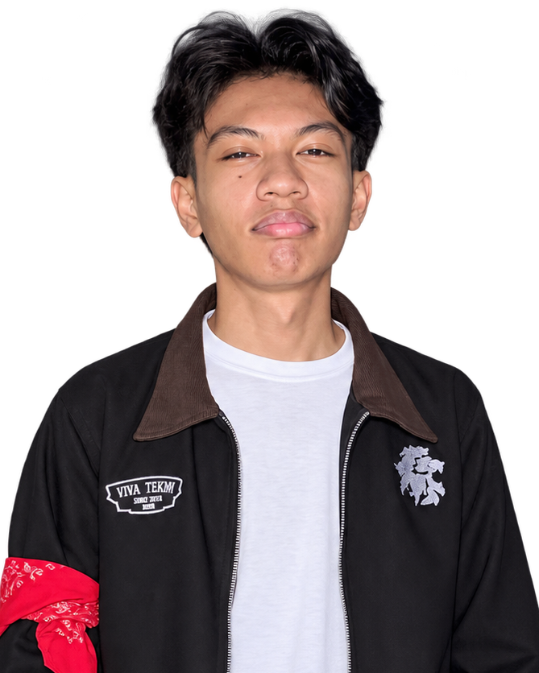

# 👨‍💻 RUDI MUSTAKIM — PORTOFOLIO WEB DEVELOPER

<p align="center">
  
</p>

<h3 align="center">Membangun Ide Menjadi Karya Digital</h3>

<p align="center">
  Website portofolio pribadi yang menampilkan profil, keterampilan, proyek, pengalaman, dan informasi kontak saya sebagai mahasiswa Informatika yang tertarik pada pengembangan web dan teknologi.
</p>

<p align="center">
  
  
  
</p>

---

## 🌐 Tentang Proyek

Website ini merupakan portofolio pribadi yang dirancang sebagai tempat untuk memperkenalkan diri, menampilkan hasil karya, serta mendokumentasikan pengalaman selama belajar dan mengembangkan proyek di bidang teknologi.

Desain website mengusung gaya **modern, minimalis, dan profesional** dengan latar belakang gelap, aksen biru, serta susunan elemen yang dibuat agar nyaman dilihat.

## ✨ Fitur dan Bagian Website

| Bagian | Deskripsi |
|---|---|
| 🏠 **Home** | Memperkenalkan diri melalui headline, deskripsi singkat, dan foto profil. |
| 👤 **About Me** | Menampilkan informasi singkat tentang diri saya. |
| 🛠️ **My Skills** | Menampilkan keterampilan yang sedang saya pelajari dan kembangkan. |
| 🚀 **My Projects** | Menampilkan beberapa proyek yang pernah saya kerjakan. |
| 🤝 **Pengabdian & Pengalaman** | Menceritakan pengalaman KKN dan magang. |
| 📬 **Contact Me** | Menyediakan tautan untuk terhubung melalui media sosial dan email. |

## 🎨 Konsep Desain

Website ini menggunakan kombinasi warna gelap dan biru untuk menciptakan tampilan yang konsisten dan berkarakter.

| Elemen | Warna | Kode |
|---|---|---|
| Latar belakang utama | Gelap | `#181A1F` |
| Area portofolio | Biru keabu-abuan gelap | `#202831` |
| Kartu konten | Abu-abu gelap | `#1D2026` |
| Tombol utama | Biru | `#1769E0` |
| Aksen dan tautan | Biru terang | `#4DA3FF` |
| Teks utama | Putih | `#FFFFFF` |
| Teks sekunder | Abu-abu | `#B7B7B7` |

### 🖼️ Tata Letak Hero Section

Bagian pembuka menggunakan foto profil yang ditempatkan berdampingan secara visual dengan teks perkenalan. Foto dan teks memanfaatkan pengaturan posisi serta lapisan elemen (`z-index`) agar tampil saling melengkapi tanpa mengganggu keterbacaan.

### 🔤 Tipografi

Website menggunakan jenis huruf **Arial, Helvetica, sans-serif**. Pemilihan ini membantu menjaga tampilan tetap sederhana, jelas, dan mudah dibaca.

### 📱 Desain Responsif

Tampilan website disesuaikan untuk berbagai ukuran layar melalui CSS Media Queries, termasuk layar desktop dan perangkat seluler.

## 🚀 Proyek yang Ditampilkan

### 🎮 1. Pembuatan Game 2D
Game berjudul **The Retired Knight's Adventure** yang dikembangkan menggunakan GDScript.

### 📱 2. Pembuatan Aplikasi Android
Aplikasi **Nongkrong Yuk**, yang dirancang untuk membantu pengguna menemukan tempat nongkrong di Malang.

### 🌐 3. Web Project
Website **Menonton Film**, sebuah proyek website bertema layanan menonton film secara daring.

## 🤝 Pengabdian dan Pengalaman

### 🌱 KKN Desa Telekung
Mengikuti kegiatan Kuliah Kerja Nyata (KKN) di Desa Telekung dengan berperan sebagai koordinator kelompok. Kegiatan ini menjadi pengalaman dalam koordinasi tim, komunikasi, dan pelaksanaan program pengabdian masyarakat.

### 💼 Magang di GOADSEO
Memiliki pengalaman magang selama satu tahun dengan kegiatan yang berkaitan dengan bidang web dan SEO.

## 🧰 Teknologi yang Digunakan

- **HTML5** — menyusun struktur dan konten halaman website.
- **CSS3** — mengatur tata letak, warna, tipografi, animasi atau efek visual, serta responsivitas.

## 📂 Struktur Proyek

```text
portfolio/
├── index.html
├── style.css
├── README.md
└── images/
    ├── rudi-foto-nobg.png
    ├── GAME.PNG
    ├── APK.png
    ├── WEB.png
    ├── KKN.jpeg
    └── MAGANG.jpeg
```

## 💻 Cara Menjalankan Website

1. Unduh atau clone repository ini.
2. Buka folder proyek di Visual Studio Code.
3. Pastikan file `index.html`, `style.css`, dan folder `images` tersedia.
4. Jalankan `index.html` menggunakan browser atau ekstensi **Live Server** di Visual Studio Code.

## 🎯 Tujuan Pengembangan

Portofolio ini dikembangkan untuk:

- Memperkenalkan profil dan minat saya di bidang Informatika.
- Mendokumentasikan proyek yang pernah dibuat.
- Menampilkan keterampilan dan pengalaman.
- Menjadi media untuk terus belajar, berkembang, dan membangun karya digital.

## 📬 Hubungi Saya

<p align="center">
  <a href="https://github.com/Rudyyz">
    
  </a>
  <a href="https://www.instagram.com/rudiyy._/">
    
  </a>
  <a href="https://mail.google.com/mail/?view=cm&fs=1&to=mrudimustakim@gmail.com">
    
  </a>
  <a href="https://www.linkedin.com/in/muhammad-rudi-mustakim-8114392a9/">
    
  </a>
</p>

---

<p align="center">
  <i>Dibuat dengan semangat belajar, kreativitas, dan keinginan untuk terus berkembang.</i>
</p>

<p align="center">
  <b>© Rudi Mustakim</b>
</p>
